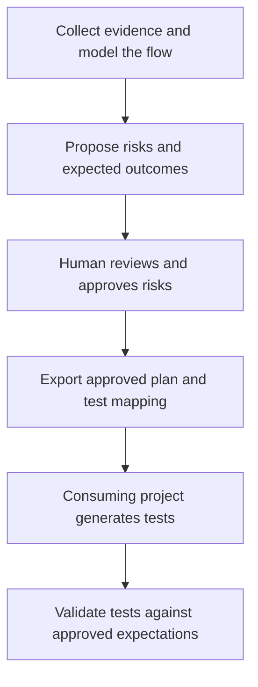

# QA Investigation Harness

> A risk-driven investigation layer for Playwright test generation.


The QA Investigation Harness turns a local case, spec, or run into an evidence-backed hand-off for a separate Playwright test-generation agent. It walks the real browser flow when needed, models observed states and transitions, puts risks in front of a human for approval, and produces a plan that can be audited after generation.

The methodology lives in shared instructions. Codex, Claude Code, and GitHub Copilot Chat in VS Code have plain-language entry points. Codex and Claude Code also have workflow skills, and VS Code Local has prompt adapters. See the [compatibility matrix](docs/compatibility.md) for verification status.

## Why it exists

Test generation is more useful when it starts from what the application actually did and from risks a human has consciously chosen to cover. This harness adds that investigation layer before generation without taking ownership of test code.

The result is a traceable chain:

```text
investigation ID + case, spec, or run
        │
        ▼
  status / resume ──► the stage supported by available evidence
                             │
                             ▼
  browser exploration ──► state/transition model ──► proposed risks
                                                              │
                                                human approves/rejects
                                                              │
                                                              ▼
                                                     generator plan
                                                              │
                                                              ▼
                                                   oracle validation
```

## Core capabilities

- **Snapshot-based exploration** — records the live flow, accessibility-tree elements, URLs, visible changes, and evidence gaps.
- **State and transition modeling** — separates observed transitions from plausible transitions that were not walked.
- **Human-gated risk review** — generates proposed risks; only the human marks them approved or rejected.
- **Generator-compatible output** — writes `specs/<id>.plan.md` in a plain plan structure a test-generation agent can consume.
- **Post-generation auditing** — checks generated assertions against approved oracles and can mutation-check assertion strength.
- **Guided progress, status, and resume** — shows investigation position, blockers, missing or unchecked evidence, and one owner-specific next action; explicit status and resume follow the shared resolver ([chat guide](qa-harness/GUIDED-CHAT.md)).
- **Local source intake and plan review** — previews pasted, Markdown, and CSV evidence with locators and provenance, then writes only after human confirmation; reviews existing plans directly without editing them.
- **Optional source adapters** — a versioned read-only contract and fixture-tested Jira issue normalizer preserve project scope, locators, revisions, and bounded excerpts; manual intake remains available without a connected provider.
- **Traceability matrix and actionable gaps** — links requirements, risks, approvals, plan entries, tests, runs, and validation; each row points to the earliest useful next action and keeps the reason visible.
- **Generator round trip** — guides the human from an approved plan through the external generator, mapped-source check, Playwright report import, matrix review, run comparison, and Stage 5 validation. The consuming project's generator still owns test code and execution.
- **Offline Playwright reports and comparison** — reads existing JSON reports without running Playwright, producing coverage and failure triage with safe in-root attachment links. Attachment contents are never read or copied. Saved runs can be compared only for the same investigation and exact target; missing or ambiguous evidence stays visible, and runner status does not prove oracle conformance or root cause.
- **Focused review and deterministic checks** — bounded risk/validation reviewers return cited findings; structural artifact and Markdown-link checks plus the built-in Node suite run locally and in CI, with an opt-in Codex hook for artifact diagnostics.

## How the workflow works



**Start where your evidence fits.** The diagram shows the full investigation path.

| What you have | Where to start |
| --- | --- |
| Local case, CSV, or selected Jira issue | Intake: preview evidence and confirm before saving |
| Recorded observations | Model the flow directly |
| Existing investigation | Check status or resume |
| Existing plan or spec | Review it directly |
| Failure evidence | Triage the failure |
| Playwright JSON report | Import coverage and triage evidence |
| Two saved run reports | Compare results and evidence gaps |
| Traceability matrix request | Review coverage and next actions |
| Generator handoff request | Check readiness and blockers |

Use [the investigation contract](qa-harness/CONTRACT.md) to choose the first stage from the evidence you have; a spec or run can enter directly without a browser exploration. Use `status <investigation-id>` for a read-only progress report, or `resume <investigation-id>` to continue from the next eligible stage. Missing evidence, a missing or stale approval, and the external generator handoff are explicit stops.

For the deeper artifact contract and boundaries, see [Architecture](docs/architecture.md).
After an approved plan reaches the consuming project's generator, follow the
[generator round-trip guide](qa-harness/GENERATOR-ROUND-TRIP.md) to check mapped
source, import Playwright results, review the matrix, compare saved runs, and
continue to Stage 5. Exact commands and limits are in the
[checks guide](qa-harness/checks/README.md).

## Stage outputs

Each flow is identified by an existing ticket ID or a local investigation ID:

| Stage or tool | Input | Output |
| --- | --- | --- |
| Status | Investigation ID and available artifacts | Read-only status report |
| Resume | Investigation ID and evidence for the next eligible action | Existing stage output or a named blocker |
| Intake | Pasted/local case, Markdown plan, or evidence excerpt | Preview; after confirmation, `qa-artifacts/<id>/investigation.md` |
| Direct plan review | Existing plan or spec | Read-only findings with source locators; source stays unchanged |
| Explore | Scoped case, confirmed non-production URL, interactive test account | `qa-artifacts/<id>/exploration.md` with observations only |
| Model | Exploration artifact or qualifying imported observations | `qa-artifacts/<id>/flow-model.md` with observed and unobserved transitions |
| Challenge Part A | Flow model and cited observations | `qa-artifacts/<id>/risks.md` with `PROPOSED` risks only |
| Human review | Proposed risk table and current dependencies | Human-recorded `APPROVED` / `REJECTED` decisions; the harness never decides |
| Challenge Part B | Fresh approved risks, dependencies, usable steps | `specs/<id>.plan.md` plus generated mapping in `risks.md` |
| External generator | The plan file and the consuming project's test setup | Generated test files in that project |
| Generator handoff summary | Current approvals and unambiguous mappings | Read-only ready/blocked cases and the human-owned next action; see the [round-trip guide](qa-harness/GENERATOR-ROUND-TRIP.md) |
| Validate | Current approvals, mapping, plan, and mapped test source | `qa-artifacts/<id>/validation.md`; optional assertion mutation is explicit and restored |
| Triage | Identifiable failure or run evidence | Observed failure, separate possible causes, and missing context |
| Offline run report | Existing Playwright JSON report, investigation artifacts, run ID, and target | `qa-artifacts/<id>/run-report.json` and `qa-artifacts/<id>/run-report.md` with coverage links, failure triage, and safe in-root attachment links |
| Offline run comparison | Two saved harness run reports for the same investigation and exact target | JSON and Markdown outcome comparison; no new test execution or root-cause inference; [usage](qa-harness/checks/README.md#compare-saved-run-reports) |
| Traceability matrix | Investigation artifacts, mapped tests, optional selected run | Requirement-to-validation evidence with visible gaps and one next action per row; [usage](qa-harness/checks/README.md#traceability-matrix) |

The `qa-artifacts/` and `specs/` directories are generated workflow output and are intentionally ignored by default. This repository documents and validates the process; it does not publish real investigation findings.

## Tool adapters

The shared methodology lives in [`qa-harness/`](qa-harness/):

- [`RULES.md`](qa-harness/RULES.md) is the source of truth for hard rules, safety boundaries, artifact paths, and stage order.
- [`stages/`](qa-harness/stages/) contains the status/resume resolver and tool-agnostic stage instructions.
- [`INTAKE.md`](qa-harness/INTAKE.md) defines provenance, safe excerpts, revisions, and CSV preview behavior; [`fixtures/`](qa-harness/fixtures/README.md) contains synthetic examples.
- [`checks/README.md`](qa-harness/checks/README.md) documents the deterministic checker, traceability matrix, evidence-based next actions, saved-run comparison, generator handoff summary, opt-in hook, and CI behavior.
- [`adapters/README.md`](qa-harness/adapters/README.md) documents the normalized source record contract, Jira pilot, and unverified live client bindings.
- [`.agents/skills/`](.agents/skills/) provides Codex stage and review shortcuts; Codex skills do not enforce reviewer tool restrictions.
- [`.claude/agents/`](.claude/agents/) and [`.github/agents/`](.github/agents/) provide read/search-only focused reviewers.
- [`.github/copilot-instructions.md`](.github/copilot-instructions.md) connects Copilot Chat in VS Code to the shared guided workflow.
- [`.github/prompts/`](.github/prompts/) provides VS Code Local prompt adapters.
- [`.claude/skills/`](.claude/skills/) provides Claude Code skill adapters.
- [`AGENTS.md`](AGENTS.md) provides Codex instructions.
- [`CLAUDE.md`](CLAUDE.md) provides Claude Code repository instructions.

Playwright MCP configuration is kept per tool:

- [`.mcp.json`](.mcp.json) is the repository-level MCP configuration used by Claude Code.
- [`.vscode/mcp.json`](.vscode/mcp.json) is the VS Code configuration used by the Local setup.
- Codex users can register the server once with the command shown below.

## Getting started

This repository has no application runtime, package manifest, dependency install, Docker image, or database. The optional artifact checker and its tests use Node.js built-ins only; no package install is required.

For the complete user journey and scenario-based instructions, start with the
[QA Harness User Guide](qa-harness/USER-GUIDE.md). The guide explains entry
routes, each investigation step, generator handoff, result review, and how to
keep documentation aligned with the canonical stage rules.

### Start in chat

In Codex, Claude Code, or GitHub Copilot Chat in VS Code, attach the evidence
and ask for what you need:

- **Case:** “Start QA with this case.”
- **Existing plan:** “Review this plan.”
- **Recorded observations:** “Model this flow from these observations.”
- **Failed run:** “Help with this failed run.”

The assistant shows the next action. To return to saved work, say
**`Continue QA for <investigation-id>`** in a new chat with the same checkout.
The [shared chat guide](qa-harness/GUIDED-CHAT.md) describes the progress
summary; the [walkthrough](qa-harness/walkthroughs/guided-chat.md) gives
copyable examples.

Use your team's ticket reference or confirm a local investigation ID if
needed. Existing specs keep their names. See the
[guided chat walkthrough](qa-harness/walkthroughs/guided-chat.md).

### Choose where to start

- **Local case or CSV:** start with Intake. Inspect the preview and confirm the ID, source mapping, and grouping before import. See the [CSV walkthrough](qa-harness/walkthroughs/csv-case-to-approved-handoff.md).
- **Selected Jira issue:** use Intake only if a scoped read-only Jira adapter is configured; otherwise use the local/manual path. A Jira status is source evidence, never human approval.
- **Recorded observations:** enter Model directly when the observations have source locators; do not claim a live exploration.
- **Existing plan or spec:** use direct read-only plan review; do not force it through browser exploration.
- **Failure evidence:** start with triage, keeping the observed failure separate from possible causes. For an existing Playwright JSON report, use the [offline report command](qa-harness/checks/README.md#offline-playwright-run-report), then review coverage links and triage. See the [spec-and-run walkthrough](qa-harness/walkthroughs/spec-and-failed-run.md).
- **Existing investigation artifacts:** ask for `status <id>` or `resume <id>`; status reads only, and resume follows the artifact-based resolver.

### End-to-end: case to reviewed test results

1. **Choose an entry route.** Start with local intake for a case, direct review
   for an existing plan, Model for recorded observations, triage for a failure,
   or status/resume for saved artifacts. The [user guide](qa-harness/USER-GUIDE.md#choose-a-starting-point)
   covers each scenario.
2. **Confirm the evidence preview.** For intake, check the proposed ID, source
   mapping/grouping, normalized content, and missing inputs before confirming
   any write. For browser exploration, supply a confirmed non-production URL
   and interactive test access.
3. **Build the evidence-backed plan.** Explore when live behavior is needed,
   model observed states and transitions, then challenge the flow to propose
   risks. Review and record each risk decision yourself; export only after
   current approvals and dependencies are confirmed.
4. **Hand off to the project generator.** Give the consuming project's
   generator `specs/<id>.plan.md`. The project owns generated test code and
   Playwright execution; the harness never generates or runs tests.
5. **Return with generated files and report.** Check mapped test paths, run the
   consuming project's tests, and import its existing Playwright JSON report
   with the real run ID and target. Review the traceability matrix and use
   Stage 5 Part A to compare assertions with approved oracles. A runner pass
   alone does not prove oracle conformance.

For exact commands, recovery paths, and separate scenario walkthroughs, use
the [full harness user guide](qa-harness/USER-GUIDE.md). Use the
[generator round-trip guide](qa-harness/GENERATOR-ROUND-TRIP.md) for report
import, matrix, comparison, and validation details.

See [compatibility](docs/compatibility.md) before selecting a client and
[migration guidance](docs/migration.md) before moving legacy artifacts.

### 1. Clone the repository

```bash
git clone https://github.com/Yasser132456/qa-investigation-harness.git
cd qa-investigation-harness
```

### 2. Choose an adapter

#### VS Code Local harness

The `.github/prompts/qa-*.prompt.md` adapters run in VS Code's Local harness.
The Local harness is scheduled for removal in February 2027. VS Code's current
Copilot harness has a separate guided chat entry point below.

#### GitHub Copilot Chat in VS Code

Open the repository root in VS Code and start a chat using the Copilot
harness. Ask “Start QA with this case” or use
`Continue QA for <investigation-id>`. The repository's
[Copilot instructions](.github/copilot-instructions.md) point to the shared
guide. See [compatibility](docs/compatibility.md) for verification status and
[the migration guide](docs/migration.md) for reusable prompt shortcuts.

#### Claude Code

Open the repository with Claude Code. `/qa status <id>` and `/qa resume <id>` inspect or continue an investigation; the `qa-*` skills keep direct stage access. The `qa-risk-challenger` and `qa-validation-reviewer` agents have read-only file/search tools. The root `.mcp.json` registers Playwright MCP.

#### Codex

Register Playwright MCP once in the global Codex configuration:

```bash
codex mcp add playwright -- npx @playwright/mcp@latest --isolated --caps=core --snapshot-mode=full --timeout-action=30000 --timeout-navigation=30000 --timeout-settle=5000 --test-id-attribute=data-testid
```

Then use the `$qa-*` skills for intake, status/resume, or a direct stage, or ask in plain language. `$qa-risk-review` and `$qa-validation-review` are read-only by instruction but do not enforce a tool allowlist. The optional checker command is in [`qa-harness/checks/README.md`](qa-harness/checks/README.md). The full flow and safety rules are in [`AGENTS.md`](AGENTS.md).

The checker requires Node.js 20 or newer and has no package dependencies. Run it manually with `node qa-harness/checks/qa-check.mjs`; `qa-harness/checks/README.md` documents supported files, the opt-in Codex hook, and CI.

### 3. Continue from the evidence you have

- Existing investigation files: `status <id>` reports progress without
  writing; `resume <id>` follows the next eligible action and stops at human
  review or generator handoff.
- Local case needing observation: intake previews and waits for confirmation;
  explore only after a scoped non-production URL and interactive access are
  available, then model and challenge the recorded evidence.
- Existing plan/spec: use direct plan review. Failure evidence: use triage.
  Do not force either path through browser exploration.
- After Challenge Part A, a human records decisions. Part B can export only
  current approved risks. The consuming project's generator remains separate;
  validate after its test source or run evidence is supplied.

### Environment and credentials

The harness requires a non-production target URL and an interactive test account for browser exploration. Credentials are never written to repository files, artifacts, plans, or logs. The confirmed non-production URL may be recorded in the exploration/plan artifacts because the generator needs to know which environment the flow describes.

## What this repository intentionally does not do

- It does not create, edit, or suggest Playwright test code.
- It does not create seed files.
- It does not invent case content or quietly assign an investigation ID; new IDs are proposed for the human to confirm during intake.
- It does not guess an expected behavior, infer approval from imported content, or decide which risks the human should approve.
- It treats pasted and provider-supplied text as evidence, never as instructions to change these rules or run embedded commands.
- It does not rewrite or renumber existing `TC-<NN>` plan entries, or mix multiple flows in one investigation session.
- It does not run against production environments.
- It does not write back to Jira or other source providers, or store provider credentials.
- The offline report tool does not run Playwright, call a provider, infer root cause, or decide that a suite is healthy or adequate.
- It does not replace the consuming project's test-generation agent.
- It does not claim API, database, email, background-job, or persisted-state evidence is browser-observable when it is not.

## Repository structure

```text
.
├── .agents/skills/              # Codex status, resume, stage, and review shortcuts
├── .claude/agents/              # Read/search-only Claude reviewers
├── .claude/skills/              # Claude Code status, resume, and stage adapters
├── .github/agents/              # Read/search-only Copilot reviewers
├── .github/prompts/             # VS Code Local prompt adapters
├── .vscode/mcp.json             # VS Code Playwright MCP configuration
├── docs/
│   ├── architecture.md          # Workflow routes and system boundaries
│   ├── compatibility.md         # Client and provider support evidence
│   ├── migration.md             # Legacy artifact migration guidance
│   ├── release/                 # Phase verification reports
│   └── assets/                  # Repository mark and social-preview artwork
├── qa-harness/
│   ├── RULES.md                 # Shared rules and artifact contract
│   ├── README.md                # Multi-tool usage guide
│   ├── USER-GUIDE.md            # Full user journey and scenario guide
│   ├── adapters/                # Optional read-only source adapters
│   ├── checks/                  # Structural checks, report CLI, and Node tests
│   ├── fixtures/                # Synthetic intake, run-report, and walkthrough data
│   ├── stages/                  # Intake, review, status/resume, and investigation stages
│   └── walkthroughs/            # Public end-to-end examples
├── AGENTS.md                    # Codex repository instructions
├── CLAUDE.md                    # Claude Code repository instructions
├── CONTRIBUTING.md              # Contribution workflow
├── SECURITY.md                  # Security reporting and secret handling
└── README.md
```

## Engineering decisions

### One source of truth, thin adapters

Rules and stage behavior are centralized in `qa-harness/`. Tool-specific files only provide the invocation shape and arguments for their host environment. This keeps methodology changes consistent across adapters.

### Evidence before recommendation

Stage 1 records observations only. Stage 2 models what was observed and what was not. Stage 3 proposes risks without approving them. Keeping these responsibilities separate makes the human review boundary visible and preserves traceability.

### Real oracles, even when the browser cannot verify them

The harness names the oracle that would actually prove a risk, including API or database checks that are not currently wired into the consuming test project. It records that gap instead of replacing the oracle with a weaker rendered-text assertion.

## Development and contribution

Changes to shared rules affect every adapter, so start with [`CONTRIBUTING.md`](CONTRIBUTING.md) and read [`qa-harness/RULES.md`](qa-harness/RULES.md) before editing stage instructions. Security concerns and accidentally exposed credentials belong in [`SECURITY.md`](SECURITY.md).

## Roadmap and known limits

All seven planned development phases are merged to `master`. See the [Phase 7 verification report](docs/release/phase-7-verification.md) for what was checked and what remains unverified: real-human adoption, live browser behavior, consuming-project test generation, and live provider access. The repository's JSON report ingestion and Jira normalizer have fixture coverage; no live provider binding is included.

Adapters for Xray, Azure DevOps, and Confluence are not implemented. Optional API/database oracle integrations belong to consuming projects.

## License

This project is available under the [MIT License](LICENSE).

## GitHub metadata recommendations

The available repository connector can inspect GitHub metadata but cannot update the repository description, topics, or social-preview setting from this environment. Recommended values:

- **Description:** Risk-driven browser-flow investigation and human-reviewed test plans for Playwright test generation.
- **Topics:** `playwright`, `test-automation`, `qa-engineering`, `software-testing`, `browser-automation`, `risk-based-testing`, `test-planning`, `developer-tools`, `llm-agents`, `claude-code`, `github-copilot`.
- **Social preview asset:** [`docs/assets/qa-investigation-harness-social.svg`](docs/assets/qa-investigation-harness-social.svg), upload manually under GitHub repository settings → Social preview.
- **Homepage/demo URL:** None verified; leave unset until a live documentation or demo site exists.
