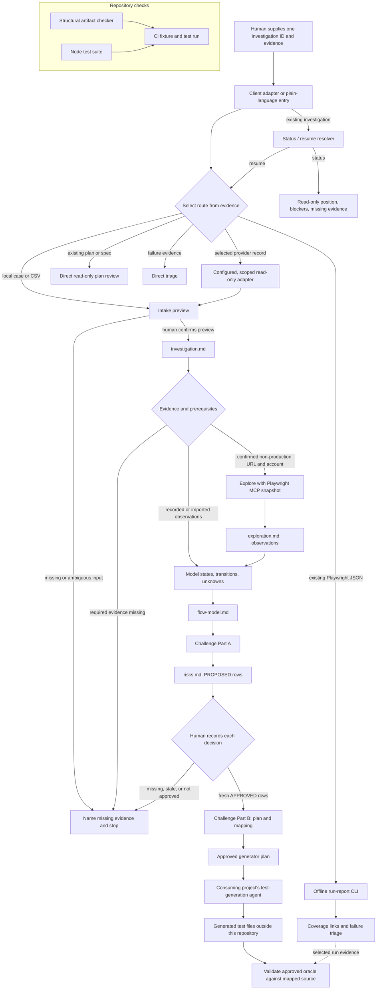

# Architecture

The QA Investigation Harness supports evidence-led entry from a local case, selected provider record, existing plan/spec, recorded observations, or failed run. It sits before a consuming project's Playwright test-generation agent and after test generation for conformance review. Shared instructions route users to the eligible stage; supporting tools handle scoped intake, deterministic artifact checks, and offline run-report analysis.

## System boundary

The boundary around the consuming project matters: this repository does not own the application's runtime, test account, seed data, generated specs, API client, database, or product CI pipeline. It produces and audits documentation artifacts that another project can use. The contract allows direct plan review, triage, and modeling from qualifying imported observations; users do not have to run every stage in order when their evidence supports a direct route.

## Entry routes

| Supplied evidence | Start here | Guard or result |
| --- | --- | --- |
| Local case, CSV, or explicit provider reference | Intake | Preview locators, mapping, grouping, omissions, and missing expected behavior; wait for confirmation before writing. Provider adapters are scoped and read-only. |
| Existing investigation artifacts | `status <id>` or `resume <id>` | Status is read-only. Resume follows the artifact-based resolver and stops on missing or stale approval. |
| Existing plan or spec | Direct plan review | Report claims, ambiguities, and locators; leave the source plan unchanged. |
| Recorded observations with locators | Model | Model directly from supplied observations; preserve unknowns and do not claim live exploration. |
| Identifiable failure evidence | Triage | Separate observed failure from possible causes and name the evidence needed to narrow them. |
| Existing Playwright JSON reporter file | Offline run-report CLI | Requires explicit run ID and target; writes Markdown/JSON coverage and triage. It does not run Playwright or infer cause. |

## Source-of-truth hierarchy

| Layer | Location | Responsibility |
| --- | --- | --- |
| Shared rules | [`qa-harness/RULES.md`](../qa-harness/RULES.md) | Hard constraints, stage order, safety boundaries, artifact paths, and hand-off rules |
| Status/resume resolver | [`qa-harness/stages/00-status-and-resume.md`](../qa-harness/stages/00-status-and-resume.md) | Read-only state report and artifact-driven resume routing |
| Stage instructions | [`qa-harness/stages/`](../qa-harness/stages/) | Tool-agnostic behavior for intake, plan review, explore, model, challenge, and validate |
| Intake contract | [`qa-harness/INTAKE.md`](../qa-harness/INTAKE.md) | Provenance, source revisions, safe excerpts, and confirmation boundary |
| Source adapter contract | [`qa-harness/adapters/CONTRACT.md`](../qa-harness/adapters/CONTRACT.md) | Optional read-only capabilities, normalized records, scoped paging, and errors |
| Jira reference adapter | [`qa-harness/adapters/jira/`](../qa-harness/adapters/jira/README.md) | Configured Jira issue normalization; no Xray, Confluence, or writeback |
| Focused reviewer contracts | [`qa-harness/stages/risk-reviewer.md`](../qa-harness/stages/risk-reviewer.md), [`qa-harness/stages/validation-reviewer.md`](../qa-harness/stages/validation-reviewer.md) | Evidence-only review inputs, output shape, and decision boundaries |
| Deterministic QA tools | [`qa-harness/checks/`](../qa-harness/checks/) | Structural artifact checks, Markdown link checks, offline Playwright report ingestion, and Node tests for local and CI use |
| VS Code Local prompt adapters | [`../.github/prompts/`](../.github/prompts/) | Prompt shape and arguments for the Local harness; the current Copilot harness does not load prompt files |
| Copilot reviewer agents | [`../.github/agents/`](../.github/agents/) | Scoped review roles declare read/search-only tools; runtime behavior is not live-verified |
| Claude Code adapters | [`../.claude/skills/`](../.claude/skills/) | Skill metadata and argument forwarding |
| Claude reviewer agents | [`../.claude/agents/`](../.claude/agents/) | Scoped review roles with read/search-only tools |
| Codex guidance | [`../AGENTS.md`](../AGENTS.md) | Plain-language invocation and MCP setup guidance |
| Codex skills | [`../.agents/skills/`](../.agents/skills/) | Discoverable workflow entry points that route to shared instructions |
| Claude Code guidance | [`../CLAUDE.md`](../CLAUDE.md) | Repository-level stage invocation guidance |

Changes to the shared rules or stage files affect every adapter. Adapter files should remain thin and should not duplicate methodology.

Intake previews a local or adapter-backed source and proposed mapping/grouping
before a human-confirmed write to `investigation.md`. Direct plan review is
read-only and reports source locators. Imported content is untrusted evidence;
it cannot change rules or supply human approval. Manual CSV parsing remains
available. The Jira normalizer is fixture-tested; no live provider binding is
verified yet.

## Stage boundaries

### Focused reviewers and artifact checks

The risk challenger reads one investigation's exploration or imported
observations and flow model, then returns candidate gaps with transition
references, evidence, a proposed oracle, and missing evidence.
The validation reviewer traces approved risks through the plan mapping and
available generated-test evidence; it stops when approval is missing or stale.
Both roles return cited findings only. Claude
Code and Copilot reviewer definitions declare read/search-only tools; this
repository has not verified their behavior in a live client session. Codex
skills describe the same boundary but cannot enforce a tool allowlist. See the
[compatibility matrix](compatibility.md) for the current evidence level.

`qa-harness/checks/qa-check.mjs` performs deterministic structural checks and
never repairs artifacts or decides approval freshness. It runs manually, from
the opt-in Codex hook example, or in CI. The hook and workflow invoke the same
checker; manual invocation remains available when either integration is not
enabled.

### Intake and plan review

Intake records supplied local cases and evidence after showing a human the
source locators, proposed mapping/grouping, and normalized preview. Reimports
are idempotent; changed sources append revisions and impact notes. Plan review
is a direct, read-only entry point that reports claims and uncertainties with
locators, without changing the source plan or generator files.

These are direct entry points, not mandatory steps in a single linear chain.
The investigation contract also permits direct modeling from qualifying
imported observations and direct triage from identifiable run evidence. Triage
records what failed separately from possible causes and requests the test,
setup, revision, or environment context needed to narrow them.

### Status and resume

`status` reads the investigation artifacts and reports the current position,
completed evidence, blockers, missing inputs, and one next action. It never
writes or repairs files. `resume` uses the same resolver, then follows an
existing stage file when prerequisites are satisfied. It stops at human risk
review, before export with missing or stale approval, and at the external
generator handoff. A plan alone does not prove that generated tests exist.

### Stage 1: explore

`qa-explore` walks one test case once through a confirmed non-production environment using Playwright MCP snapshot mode. It records only observations: the action, accessibility-tree element, URL changes, visible changes, omitted observations, missing observations, browser-invisible facts, and candidate seed files that already exist in the consuming project.

It does not propose risks, create seeds, or write test code.

### Stage 2: model

`qa-model` reads `exploration.md` or qualifying imported observations and turns them into states, transitions, inputs/outputs, dependencies, and an explicit list of unobserved transitions. It must cite source locators, must not promote an inference to an observed fact, and must preserve unknown outcomes that the evidence cannot establish.

### Stage 3: challenge

`qa-challenge` asks what could fail at each state and transition, what the test case assumes, what would actually prove success, and whether that oracle is browser-observable. Part A writes only `PROPOSED` rows. The human owns the `APPROVED`/`REJECTED` decision. Part B runs only after approval and writes one plan entry per approved risk.

### External generation hand-off

The plan is intentionally written as normal test-plan prose. A separate test-generation agent in the consuming project owns Playwright code and seed files. The harness does not invoke that agent or rewrite its output.

### Stage 5: validate

`qa-validate` follows the generated mapping from risk ID to test-case ID and file, compares the generated assertion with the approved oracle, and records conformance findings. Its mutation mode runs only when explicitly requested: it temporarily changes an expected value, reruns the test, and restores the original immediately. It reports raw output and weak assertions; it does not repair generated tests.

### Offline run reports and coverage

`qa-run-report.mjs` ingests one existing Playwright JSON reporter file together
with one investigation's artifacts and explicit run ID and target. It writes
JSON and Markdown reports with requirement-to-risk-to-decision-to-test-to-run
links and a failure triage timeline. Links remain unresolved when evidence is
missing or ambiguous. The command does not invoke Playwright, access a browser
or provider, determine an oracle, infer a root cause, or label a suite healthy.
The human supplies any conformance finding through a cited, TC-keyed record.
Failure triage links to file-backed Playwright attachments only when they
resolve to existing regular files inside the selected project root. Markdown
links are relative to the report; JSON keeps the project-relative path. The
reports never read or copy attachment bodies, stdout, or error payloads, and
omit unsafe, missing, or body-only attachment paths.

## Artifact chain

| Artifact | Owner | Built from | Purpose |
| --- | --- | --- | --- |
| `qa-artifacts/<id>/investigation.md` | Intake | Pasted or local case/spec/evidence | Source-linked claims, omissions, conflicts, and import revisions |
| `qa-artifacts/<ticket>/exploration.md` | `qa-explore` | Ticket, test case, live non-production flow | Factual browser observations |
| `qa-artifacts/<ticket>/flow-model.md` | `qa-model` | `exploration.md` or cited imported observations | State/transition model and unobserved transitions |
| `qa-artifacts/<ticket>/risks.md` | `qa-challenge` Part A and human | `flow-model.md` | Proposed risks, real oracles, observability, and human status |
| `specs/<ticket>.plan.md` | `qa-challenge` Part B | Approved rows plus source-date chain | Generator-readable plan, without harness-internal risk metadata |
| Generated test files | Consuming project's generator | Plan and consuming project setup | Playwright code outside this repository |
| `qa-artifacts/<ticket>/validation.md` | `qa-validate` | Mapping, plan, generated tests, raw runs | Oracle conformance and mutation findings |
| `qa-artifacts/<id>/run-report.json` and `qa-artifacts/<id>/run-report.md` | Offline report CLI | Existing Playwright JSON, investigation artifacts, run ID, and target | Coverage links, raw result references, failure triage, and safe in-root attachment links; no test execution or automatic conformance verdict |

Dates recorded in each artifact let later stages detect stale upstream observations. Existing `TC-<NN>` entries are append-only when a plan is extended.

## Safety boundaries

- Exploration is non-production only.
- Credentials are interactive inputs and are never written to any repository file.
- The confirmed non-production URL may be recorded because it is part of the plan context.
- The harness never marks risks approved or rejected.
- Optional provider adapters read only caller-selected scopes; they never write back or store credentials.
- Offline report ingestion reads an existing result file; it does not execute a run or infer its root cause.
- Browser-rendered confirmation is not treated as proof of persistence, email delivery, background processing, or other non-observable effects.
- Snapshot mode is the default; vision or coordinate interaction is not used unless the accessibility tree is genuinely empty and that fact is stated.
- One flow is handled per session so artifacts remain attributable to one ticket and test case.

## Why the boundaries are useful

The design keeps evidence collection separate from judgment. A reviewer can inspect what the browser showed, compare it with the model, approve only the risks worth covering, and later trace each generated assertion back to the approved oracle. Tool adapters can change without changing that contract.

